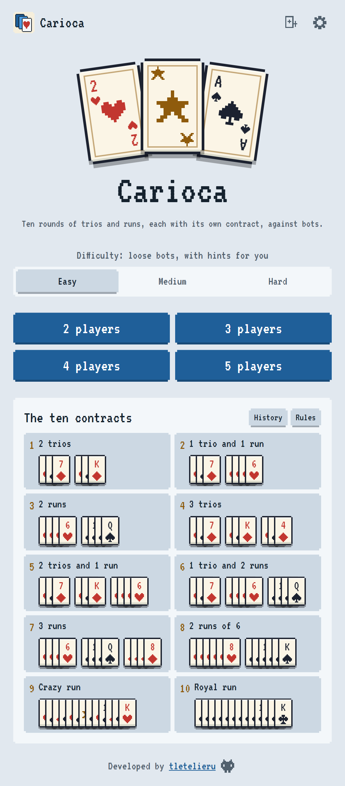
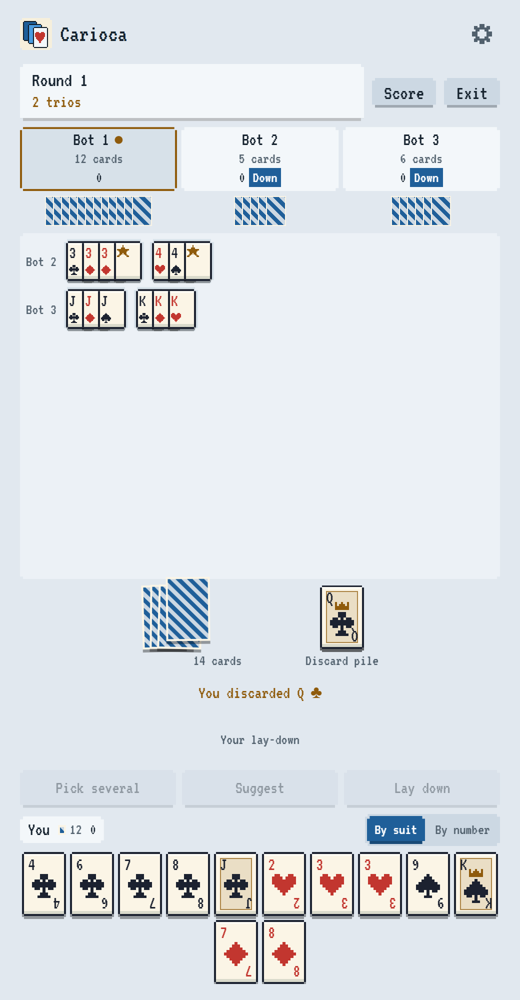
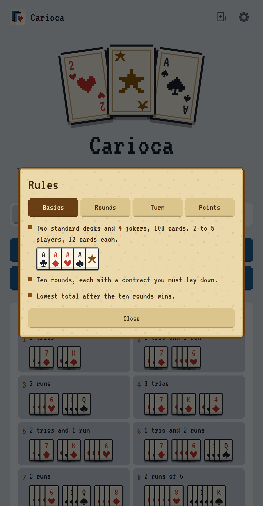

# Carioca

Play Carioca, the Chilean rummy, on your phone or computer. Ten rounds of trios and runs, each with
its own contract, against bots that count cards.

No account and no backend. Everything runs on your device, and your match is saved after every move.

- **Players:** 2–5, you against 1 to 4 bots
- **Deck:** Two standard decks and 4 jokers, 108 cards, 12 per player
- **Live:** https://tletelieru.github.io/carioca/

<p align="center">
  
  
  
</p>

## The ten contracts

Lowest total after the ten rounds wins.

| # | Contract |
| --- | --- |
| 1 | Two trios |
| 2 | A trio and a run |
| 3 | Two runs |
| 4 | Three trios |
| 5 | Two trios and a run |
| 6 | A trio and two runs |
| 7 | Three runs |
| 8 | Two runs of 6 cards |
| 9 | Crazy run (escala loca): 13 cards in a row, one of each number, suits mixed |
| 10 | Royal run: all 13 cards of one suit |

A trio is 3 cards of the same number, a run is 4 in a row of the same suit (any suits in the crazy
run), and the Ace sits between the King and the 2, so runs can wrap: Q K A 2 3. Each turn you draw from
the deck or take the last discard and discard one. From your second turn you may lay down your contract
once, with exactly the cards it asks for, and from the turn after that you may add cards to either end
of any set on the table. Cards left in hand count against you: number cards at face value, J, Q and K
10, Aces 20, jokers 30. The full rules, with card examples, are inside the game.

## What you get

- **Three difficulties:** Easy shows hints (Suggest and highlighted sets) against loose bots. Medium
  and Hard give no hints. No bot ever sees your cards
- **Your hand, your way:** drag cards to sort them, or sort by number or by suit. Tap a card to raise it and tap it again to discard; tap the deck or the discard twice to draw
- **Build your own sets:** group cards and lay down when you choose; if the groups don't meet the
  contract, the game tells you, no penalty
- **Dealer draw:** a quick draw shows who deals each new match
- **Match history:** finished and abandoned matches, with the score of every round
- **Saved matches:** reload, close the tab or turn off your phone, and the match comes back
- **Chiptune music:** its own Dorian themes, written in code, with a switch to mute it

### Accessibility and comfort

Settings has larger text sizes, a regular font instead of the pixel one, four-color suits and a switch
to turn off animations. It also comes in English and Spanish, with light and dark mode. Install it as
an app and it works offline.

## How strong are the bots?

Each row is one bot against a table of the other, 4 players, with the seat rotating every match.
Lower points are better.

| Bot | Against | Matches | Wins | Avg points | Field avg | Even odds |
| --- | --- | --- | --- | --- | --- | --- |
| Medium | Easy | 200 | 94.0% ±3.3 | 183 | 532 | 25% |
| Hard | Medium | 200 | 31.5% ±6.4 | 324 | 349 | 25% |
| Hard | Easy | 200 | 95.5% ±2.9 | 152 | 543 | 25% |

## Run it locally

Requires Node 24 and pnpm 9.

```sh
pnpm install
pnpm dev        # http://localhost:5173/carioca/
```

| Command | What it does |
| --- | --- |
| `pnpm test` | Runs the unit and property tests |
| `pnpm lint` | Runs ESLint |
| `pnpm typecheck` | Runs the type checks |
| `pnpm build` | Builds the app |
| `pnpm sim` | Plays the bot ladder: medium vs easy, hard vs medium, hard vs easy |

The screenshots above come from `apps/client/scripts/readme-shots.mjs`, which drives the dev server on
port 5199 with Playwright.
| `pnpm sim --hero hard --field medium --matches 100 --players 3` | Plays one pairing |

## How it works

| Folder | What lives there |
| --- | --- |
| `packages/engine` | Rules, legal moves, the meld solver and scoring, with no UI code |
| `packages/bots` | Easy, Medium and Hard |
| `apps/client` | The game, built with React, Tailwind and Vite |
| `apps/sim` | Command line tool for bot matches |

The engine is pure and serializable, so saved matches, the bots and a future online server all share
it. Every rule that varies between tables (hand size, jokers per set, Ace, royal run, points) lives in
one `RulesConfig`. Bots only receive what their seat can see. Property tests play thousands of random
moves and check that the 108 cards are never lost or duplicated, that the solver finds every contract
and rejects broken lay-downs, and that every action outside the legal list is rejected.

The meld solver counts cards by type, combines the smallest trios and run windows that fit the
contract, and keeps the lay-down that leaves the fewest points in hand. Bots use a fast distance to the
contract to choose what to keep; Hard also weighs dead cards, counts the outs of each hand and watches
what every rival picks up. They run in a Web Worker, so the table never freezes.

All cards, icons and music are original. See [the development plan](docs/PLAN.md), in Spanish, for
what comes next.

## License

Copyright (c) 2026 tletelieru. All rights reserved. See [LICENSE](LICENSE).

---

Developed by [tletelieru](https://tletelieru.github.io/tletelieru/) · [GitHub](https://github.com/tletelieru)
